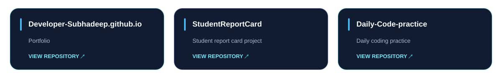

  

  

  <a href="https://developer-subhadeep.github.io/"><strong>↗ View my Portfolio</strong></a>

## About

I’m **Subhadeep Samal**, a Java Backend Developer based in **Bhubaneswar, Odisha**. I hold a **B.Tech in Computer Science Engineering** and enjoy building practical backend applications.

## Skills

  

## Featured Projects

  

- [Developer-Subhadeep.github.io](https://github.com/Developer-Subhadeep/Developer-Subhadeep.github.io) — Portfolio
- [StudentReportCard](https://github.com/Developer-Subhadeep/StudentReportCard)
- [Daily-Code-practice](https://github.com/Developer-Subhadeep/Daily-Code-practice)

## Connect

- [GitHub](https://github.com/Developer-Subhadeep)
- [LinkedIn](https://www.linkedin.com/in/subhadeep-samal/)
- [Email](mailto:hellosubhadeep32@gmail.com)

  

