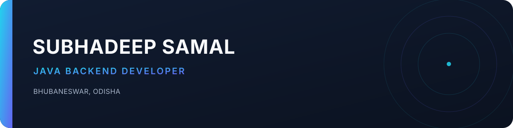

  

  

  

## About

I’m **Subhadeep Samal**, a Java Backend Developer based in **Bhubaneswar, Odisha**. I hold a **B.Tech in Computer Science Engineering** and enjoy building practical backend applications.

## Skills

## Featured Projects

- [Developer-Subhadeep.github.io](https://github.com/Developer-Subhadeep/Developer-Subhadeep.github.io) — Portfolio
- [StudentReportCard](https://github.com/Developer-Subhadeep/StudentReportCard)
- [Daily-Code-practice](https://github.com/Developer-Subhadeep/Daily-Code-practice)

## GitHub Stats

  <picture>
    <source media="(prefers-color-scheme: dark)" srcset="https://github-readme-stats.vercel.app/api?username=Developer-Subhadeep&amp;show_icons=true&amp;hide_border=true&amp;theme=github_dark&amp;title_color=22D3EE&amp;icon_color=22D3EE">
    <source media="(prefers-color-scheme: light)" srcset="https://github-readme-stats.vercel.app/api?username=Developer-Subhadeep&amp;show_icons=true&amp;hide_border=true&amp;theme=default&amp;title_color=0E7490&amp;icon_color=0E7490">
    
  </picture>

## Connect

- [GitHub](https://github.com/Developer-Subhadeep)
- [LinkedIn](https://www.linkedin.com/in/subhadeep-samal/)
- [Email](mailto:hellosubhadeep32@gmail.com)
